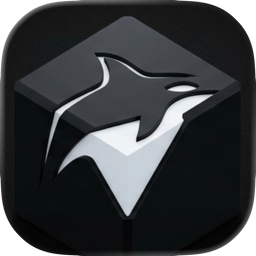
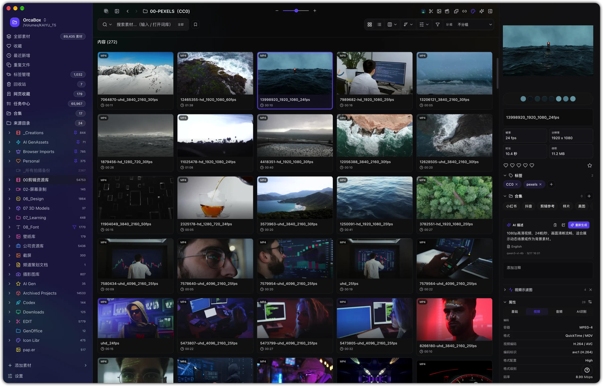
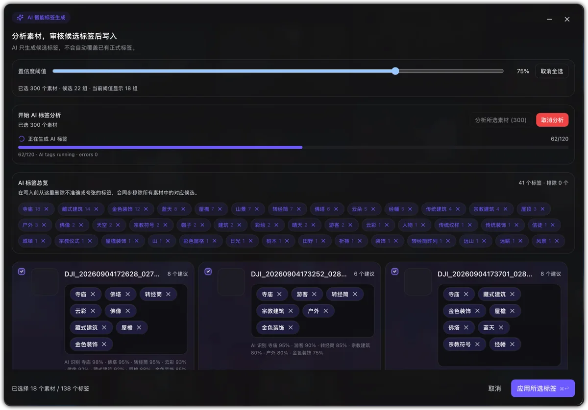
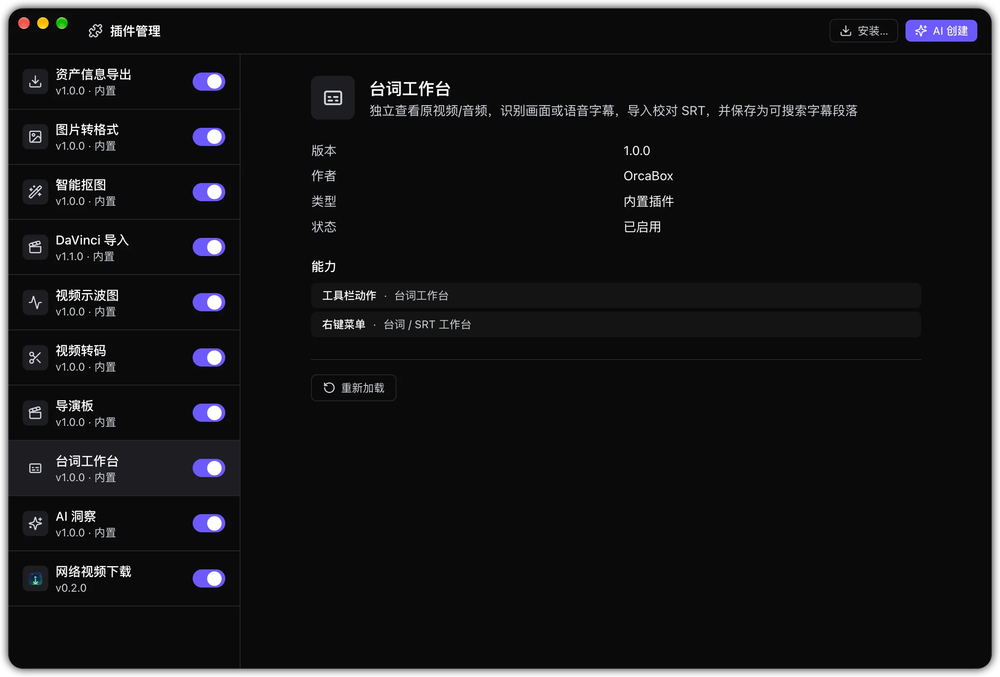
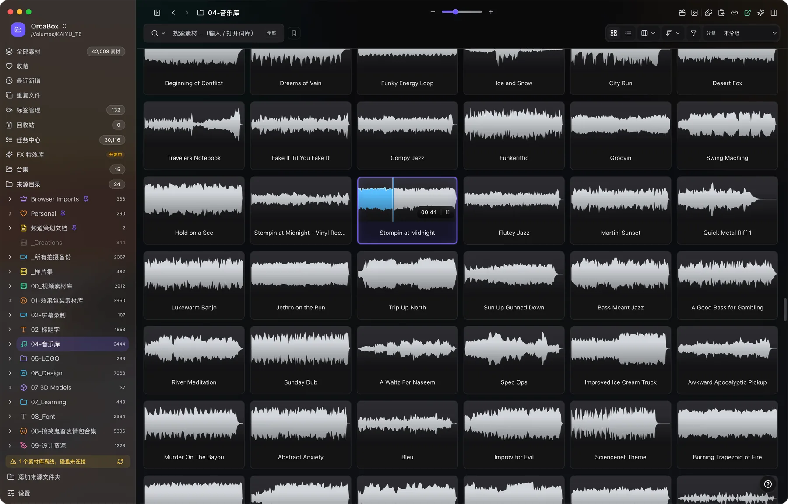
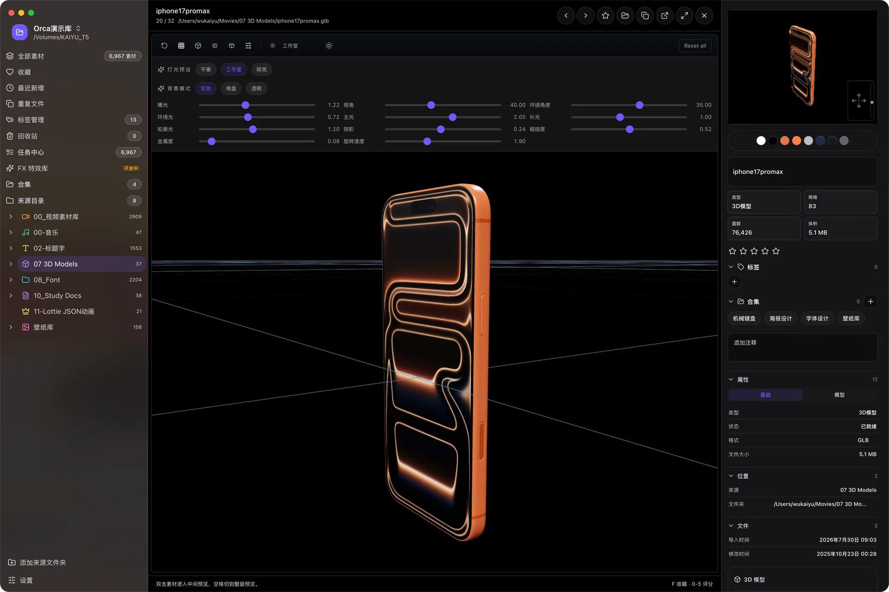
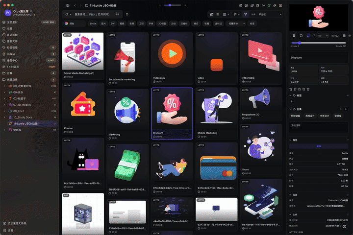

<h1 align="center">OrcaBox</h1>

<strong>크리에이터를 위한 로컬 우선 멀티 포맷 에셋 관리자</strong>

원본 파일을 옮기지 않고 여러 디스크와 프로젝트 폴더에 흩어진 에셋을 검색, 미리보기, 재사용할 수 있는 라이브러리로 정리합니다.

  
  
  
  

   

<a href="https://garrygit888.github.io/OrcaBox-Release/">공식 웹사이트</a> · <a href="https://cnb.cool/garrykai/orcabox-release/-/releases/tag/v1.4.0">CNB 다운로드</a> · <a href="https://github.com/GarryGit888/OrcaBox-Release/releases/tag/v1.4.0">GitHub 다운로드</a> · <a href="./OrcaBox-1.4.0-Release-Notes.KO.md">릴리스 노트</a>

## OrcaBox 소개

OrcaBox는 영상 편집자, 디자이너, 모션 아티스트, 사진가와 크리에이티브 팀을 위한 데스크톱 앱입니다. 기존 폴더를 추가하면 원래 폴더 구조를 유지한 채 로컬 인덱스를 만들고 미리보기, 검색, 태그, 컬렉션, 평점, 색상 필터와 AI 정리를 하나의 작업 공간에 모읍니다.

| 원칙 | 설명 |
| --- | --- |
| 로컬 우선 | 인덱스, 데이터베이스와 주요 분석을 기기 안에서 처리합니다. |
| 무복제 정리 | 원본 파일을 이동하거나 복제하지 않고 현재 저장 위치를 그대로 사용합니다. |
| 멀티 포맷 | 이미지, 영상, 오디오, Lottie, 3D, 폰트, 문서와 프로젝트 파일을 함께 탐색합니다. |
| 제작 흐름 중심 | 웹 수집, 검색, 정리와 편집 프로그램 전달 과정을 짧게 연결합니다. |

## 주요 기능

- 내부 디스크, 외장 드라이브, 마운트 스토리지와 여러 프로젝트 경로의 로컬 인덱싱.
- 이미지, 영상, 오디오, 모션, 3D, 폰트, 문서 등 40개 이상의 포맷 미리보기.
- 키워드, 파일 유형, 평점, 태그, 색상, 날짜와 폴더를 조합한 검색.
- 컬렉션, 스마트 폴더, 즐겨찾기, 평점, 메모, 태그와 일괄 작업.
- 온디바이스 AI 기반 시각 분석, 스마트 태그와 색상 검색, 선택형 원격 API 연결.
- 안정적인 Lottie 라이브 미리보기, 오디오 파형과 연속 재생.
- 플러그인 관리, 브라우저 수집, 변환 도구와 DaVinci Resolve 연동.
- Apple Silicon, Intel Mac, Windows x64 지원.

## 최근 주요 업데이트

아래 기능은 v1.4.0 – v1.4.0에 정식 출시되었습니다. 자세한 내용은 [릴리스 노트](./OrcaBox-1.4.0-Release-Notes.KO.md)를 참고하세요.

- **네트워크 영상 다운로더** — 독립 패널에 YouTube / Bilibili / 더우인(抖音) / 샤오홍슈 / Instagram 링크를 한꺼번에 붙여넣어 다운로드합니다. 카드별 해상도 선택이 가능하고, 다운로드한 파일은 자동으로 라이브러리에 들어옵니다. 엔진 자동 설치, 이어받기, 4K 다운로드 지원.
- **샤오홍슈 노트 일괄 가져오기** — 노트 링크 하나로 노트의 모든 이미지와 Live Photo를 한 번에 가져옵니다. 로그인 후에는 워터마크 없는 원본 이미지를 저장합니다.
- **앱 내 계정 로그인** — 설정에서 샤오홍슈 / 더우인에 로그인합니다. 자격 증명은 OrcaBox 자체 분리 파티션에 저장되며 시스템 브라우저에 영향을 주지 않습니다.
- **온디바이스 AI** — 스마트 태그, 시맨틱 검색, AI 플러그인 생성을 모두 로컬에서 실행합니다.
- **몰입형 전체 화면 재생** — 재생 중 UI가 페이드아웃되고 화면이 창 전체를 채웁니다. 4K VP9/Opus, HEVC, ProRes, MKV 등 원본 파일을 직접 재생하며 미리보기용 영상 프록시를 만들지 않습니다.
- **대사 워크벤치** — 로컬 음성 인식으로 자막을 생성합니다. 조각 자동 병합, 파형 정지 구간에 자막 경로 스냅, SRT / VTT 내보내기 지원.
- **제작 도구 연동** — DaVinci Resolve 원클릭 가져오기, Lightroom / Bridge 평점(XMP) 동기화.

## 플러그인

플러그인 센터에서 작업 흐름에 맞춰 내장 플러그인을 활성화할 수 있습니다.

| 플러그인 | 기능 |
| --- | --- |
| 네트워크 영상 다운로더 | YouTube / Bilibili / 더우인 / 샤오홍슈 / Instagram 링크 일괄 다운로드. 독립 패널, 해상도 선택, 이어받기 지원 |
| Pinterest 유사 이미지 검색 | 라이브러리 이미지로 Pinterest 유사 이미지 검색. 보드 탐색, 키워드 검색, 일괄 다운로드 지원 |
| 노래 인식 | 재생 중인 음악을 멀티포인트 샘플링으로 인식하고 결과와 커버를 라이브러리에 저장 |
| AI 플러그인 빌더 | 자연어로 사용자 지정 플러그인을 생성. API 레퍼런스와 코드 미리보기 포함 |
| 웹 수집 | 웹 이미지와 콘텐츠를 드래그 앤 드롭으로 라이브러리에 가져오기 |

## 제품 미리보기

<table>
  <tr><td width="50%"> <strong>AI 스마트 태그</strong> 에셋을 일괄 분석하고 검토한 뒤 태그를 적용합니다.</td><td width="50%"> <strong>플러그인 센터</strong> 작업 흐름에 맞춰 기능을 활성화하고 관리합니다.</td></tr>
  <tr><td width="50%"> <strong>오디오 라이브러리</strong> 파형, 재생, 검색과 일괄 정리를 지원합니다.</td><td width="50%"> <strong>인터랙티브 3D</strong> 모델, 재질과 기본 정보를 확인합니다.</td></tr>
</table>

 Lottie / JSON 에셋은 그리드 안에서도 라이브 미리보기를 유지합니다.

## 지원 에셋

이미지 및 디자인(PNG / JPG / WEBP / SVG / PSD / AI / EPS / HEIC), 영상(MP4 / MOV / MKV / WebM), 오디오(MP3 / WAV / FLAC / AAC), Lottie / `.lottie`, 3D(GLB / GLTF / OBJ / FBX / USDZ), 폰트, PDF, Markdown, Office 문서, Premiere Pro / After Effects / DaVinci Resolve / Final Cut Pro / Sketch 프로젝트 및 아카이브를 지원합니다.

세부 지원 범위는 포맷, 운영체제와 로컬 미디어 런타임에 따라 달라집니다. 영상은 원본 파일을 안전한 브라우저 직접 재생 또는 OS / 네이티브 미디어 기능으로 재생하며 미리보기용 영상 프록시를 생성하지 않습니다.

## 다운로드

| 플랫폼 | 다운로드 |
| --- | --- |
| macOS Apple Silicon | [DMG](https://cnb.cool/garrykai/orcabox-release/-/releases/download/v1.4.0/OrcaBox-1.4.0-arm64.dmg) |
| macOS Intel | [DMG](https://cnb.cool/garrykai/orcabox-release/-/releases/download/v1.4.0/OrcaBox-1.4.0-x64.dmg) |
| Windows x64 | [설치 프로그램](https://cnb.cool/garrykai/orcabox-release/-/releases/download/v1.4.0/OrcaBox-1.4.0-win-x64-Setup.exe) / [포터블](https://cnb.cool/garrykai/orcabox-release/-/releases/download/v1.4.0/OrcaBox-1.4.0-win-x64-Portable.exe) |

## 개발 언어와 기술 스택

      

   

**이 공개 릴리스 저장소에는 OrcaBox의 비공개 소스 코드가 포함되지 않습니다.** 설치 파일 정보, 공개 문서, 웹사이트와 제품 이미지 자료만 제공합니다. 문제를 제보할 때는 버전, 운영체제와 CPU, 재현 단계, 필요한 이미지 또는 로그를 [GitHub Issues](https://github.com/GarryGit888/OrcaBox-Release/issues)에 첨부해 주세요.

---

Copyright 2024-2026 OrcaBox. All rights reserved.

